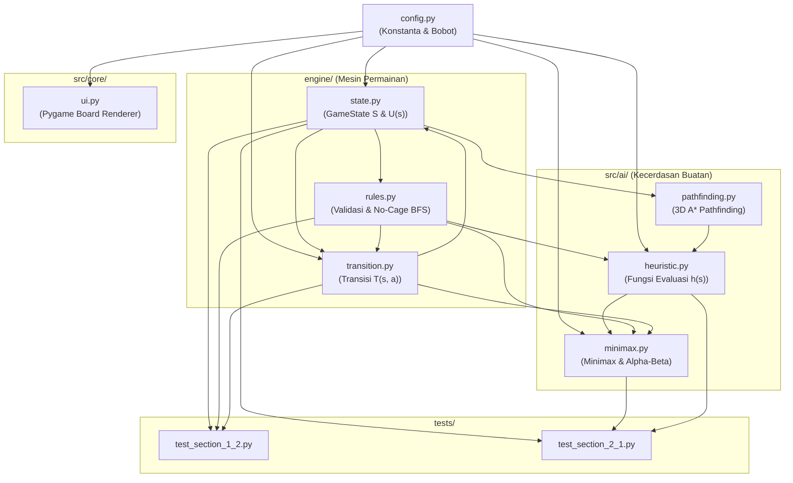

# Analisis Arsitektur Kodebase, Struktur File, & Call Hierarchy
## Proyek: Quoridor Chase: Lockdown
**Mata Kuliah:** Artificial Intelligence (Semester 5) — Universitas Ciputra  
**Kelompok:** Grup BESAR  
- Amadeus Ian Gunadi (Deus) — `0706012410051`
- Christian Owen Tengkawan (Owen) — `0706012410048`
- Michelle Mercy Phe (Michelle) — `0706012410010`
- Muhammad Althaf Hilmi (Althaf) — `0706012410065`

---

## 1. Peta Struktur Direktori Proyek

```text
QuoridorChase/
├── config.py                                        # [1] Pusat konfigurasi, parameter grid, skor, bobot heuristik
├── engine/                                          # [2] Mesin Inti Permainan (Task 1.2 - Deus, Althaf)
│   ├── __init__.py                                  # Ekspor antarmuka modular paket engine
│   ├── state.py                                     # Formalisasi State Space S, S0, cloning cepat, utilitas U(s)
│   ├── rules.py                                     # Aturan langkah legal, Smash, Rope, BFS No-Complete-Cage
│   └── transition.py                                # Model Transisi T(s, a), decay tembok, welding, scoring
├── src/                                             # [3] Logika AI & UI Lanjutan (Task 2.1, 2.2 & Visual)
│   ├── ai/
│   │   ├── __init__.py                              # Ekspor modul AI
│   │   ├── pathfinding.py                           # 3D A* Pathfinding (x, y, has_smash) & Manhattan distance
│   │   ├── heuristic.py                             # Fungsi Evaluasi Heuristik h(s) 5-parameter & Confinement
│   │   └── minimax.py                               # Minimax + Alpha-Beta Pruning + Candidate Move Filtering
│   └── core/
│       └── ui.py                                    # Antarmuka grafis 2D Pygame (Grid 9x9, Orbs, Agents)
├── tests/                                           # [4] Rangkaian Unit Test Otomatis (Pytest)
│   ├── test_section_1_2.py                          # 8 Unit test untuk Mesin Inti & Aturan Game
│   └── test_section_2_1.py                          # 6 Unit test untuk Minimax, Alpha-Beta, & Efisiensi Pruning
├── docs/                                            # [5] Dokumentasi Formal Akademik
│   ├── Bagian_1_2_Pemodelan_State_Space_dan_PEAS.md # Laporan formal spesifikasi matematis
│   └── Analisis_Arsitektur_dan_Call_Hierarchy.md    # Dokumen analisis komprehensif ini
└── *.ipynb                                          # [6] Jupyter Notebooks untuk Demonstrasi Interaktif
    ├── Bagian_1_2_Pemodelan_State_Space_dan_PEAS.ipynb
    └── Bagian_2_1_Minimax_dan_Alpha_Beta.ipynb
```

---

## 2. Diagram Alur Pemanggilan (*Call & Dependency Graph*)



---

## 3. Analisis Mendalam Masing-Masing File (*Line-by-Line & Call Hierarchy*)

---

### A. `config.py`
*Pusat konfigurasi konstanta global, geometri papan, bobot heuristik proposal, nilai utilitas, dan token tema UI.*

#### 1. Rincian Sintaks & Baris Kode:
* **Baris 7–14 (Board Geometry & Initial Coordinates):**
  * `GRID_SIZE = 9`: Ukuran dimensi grid arena $9 \times 9$.
  * `AI_START_POS = (4, 4)`: Sel koordinat awal untuk AI Boss tepat di tengah papan.
  * `RUNNER_START_POSITIONS = [(0, 4), (8, 4)]`: Sel posisi awal Runner 1 dan Runner 2 di sisi utara dan selatan.
  * `RESPAWN_CANDIDATE_CORNERS = [(0, 0), (0, 8), (8, 0), (8, 8)]`: 4 petak sudut papan untuk lokasi respawn aman (*Phase-Blink*).
* **Baris 17–28 (Game Timers, Mechanics, & Cooldowns):**
  * `MATCH_DURATION_SECONDS = 300`: Jam waktu maksimal pertandingan (5 menit).
  * `SHOT_CLOCK_SECONDS = 10.0`: Batas waktu per giliran (10 detik per langkah).
  * `SMASH_COOLDOWN_INITIAL = 0`: AI Boss memulai permainan dengan skill Smash siap digunakan (READY/Overload).
  * `SMASH_COOLDOWN_RESET = 3`: Cooldown 3 giliran setelah skill Smash dieksekusi.
  * `SOLO_WALL_LIFETIME = 2`: Durasi Solo Wall aktif selama 2 giliran sebelum otomatis hancur.
  * `INITIAL_RUNNER_ROPES = [1, 1]`: Masing-masing Runner membawa 1 item Grappling Rope sekali pakai.
  * `ACTIVE_ORB_TARGET_COUNT = 3`: Jumlah Data Orbs aktif di papan selalu dijaga 3 buah.
  * `WALL_SPAN_TILES = 2`: Panjang tembok standar Quoridor yang membentang 2 petak alur.
* **Baris 30–47 (Scoring, Heuristic Weights, & Utility Values):**
  * `POINTS_AI_TAG = 40`: Skor didapat AI Boss saat berhasil menangkap seorang Runner.
  * `POINTS_RUNNER_ORB = 15`: Skor didapat Runners saat berhasil menginjak dan mengambil Data Orb.
  * `W1_CLOSEST_RUNNER = 32.0`, `W1_SECOND_RUNNER = 4.0`: Bobot kedekatan AI ke Runner terdekat dan terjauh.
  * `W2_ORB_ACCESS = 4.0`: Bobot penalti/bonus jarak Runner menuju Data Orbs.
  * `W3_SKILL_READY_BONUS = 25.0`, `W3_SKILL_COOLDOWN_PENALTY = -5.0`: Nilai insentif kesiapan skill Smash.
  * `W4_ROPE_PENALTY = 18.0`: Nilai kewaspadaan terhadap sisa Grappling Rope Runners.
  * `W5_CONFINEMENT_SCALE = 35.0`: Bobot kurungan (*confinement score*) dari hasil Flood-Fill.
  * `UTILITY_AI_WIN = 1000.0`, `UTILITY_RUNNER_WIN = -1000.0`, `UTILITY_DRAW = 0.0`: Nilai fungsi utilitas terminal $U(s)$.
* **Baris 50–68 (`THEME_TOKENS`):**
  * Palet warna Hex Cyber Dark (`cyber_bg: #090d16`, `ai_crimson: #ef4444`, `runner_cyan: #06b6d4`, dll.).

#### 2. Call Hierarchy (Di Mana File/Sintaks Ini Dipanggil):
* `GRID_SIZE`, `AI_START_POS`, `RUNNER_START_POSITIONS` dipanggil oleh:
  * `engine/state.py` (Baris 80–82 pada default constructor `GameState`).
  * `src/core/ui.py` (Baris 4–5 & 34–35 untuk ukuran layar dan penempatan pion visual).
  * `src/ai/minimax.py` (Baris 33 untuk batasan grid).
* `SMASH_COOLDOWN_RESET`, `SOLO_WALL_LIFETIME` dipanggil oleh:
  * `engine/transition.py` (Baris 8–9, 54, 67, 124 untuk pembaruan status state).
* `W1` s/d `W5` dipanggil oleh:
  * `src/ai/heuristic.py` (Baris 2–4 untuk kalkulasi fungsi evaluasi $h(s)$).
* `UTILITY_AI_WIN`, `UTILITY_RUNNER_WIN`, `UTILITY_DRAW` dipanggil oleh:
  * `engine/state.py` (Baris 249–253 pada method `get_utility()`).
  * `src/ai/heuristic.py` (Baris 34–38 pada evaluasi terminal state).
* `THEME_TOKENS` dipanggil oleh:
  * `src/core/ui.py` (Baris 25–31 untuk inisialisasi warna Pygame).

---

### B. `engine/state.py`
*Representasi formal State Space $S$, Initial State $S_0$, caching tembok, dan fungsi utilitas terminal.*

#### 1. Rincian Sintaks & Baris Kode:
* **Baris 30–33 (`canonical_edge(c1, c2)`):**
  * Mengurutkan dua koordinat sel `(c1, c2) if c1 <= c2 else (c2, c1)`. Menjamin representasi alur tembok unik dan konsisten di dalam Python `set` atau `dict`.
* **Baris 35–54 (`edge_to_groove` & `groove_to_edge`):**
  * Konversi bolak-balik antara canonical edge `((x, y), (nx, ny))` dan format alur string `('H'/'V', x, y)` untuk keperluan serialisasi JSON / WebSocket / UI.
* **Baris 56–76 (`GameState.__slots__`):**
  * Mendeklarasikan 18 atribut tetap tanpa `__dict__` dinamis. Ini menghemat memori hingga 60% dan mempercepat pembacaan atribut selama penelusuran ribuan node Minimax.
* **Baris 78–116 (`GameState.__init__`):**
  * Konstruktor yang menginisialisasi seluruh tupel ruang keadaan $S$: koordinat agen, dictionary tembok solo beserta $TTL$, set tembok co-op, posisi 3 orb, cooldown skill, sisa rope, skor, dan giliran.
* **Baris 118–149 (`create_initial_state(cls, seed=42)`):**
  * Factory method untuk memproduksi *Initial State* $S_0$ secara deterministik. Memilih 3 sel acak kosong untuk Data Orbs awal.
* **Baris 151–172 (`clone(self)`):**
  * Kloning cepat (*fast shallow clone*) menggunakan `__new__` dan penyalinan referensi koleksi (`.copy()`). Jauh lebih cepat daripada `copy.deepcopy()`.
* **Baris 173–185 (`all_walls(self)` & `invalidate_wall_cache()`):**
  * Mengembalikan gabungan `set(self.solo_walls.keys()) | self.coop_walls`. Menggunakan cache internal `_cached_all_walls` yang hanya dihitung ulang saat ada perubahan tembok (`invalidate_wall_cache`).
* **Baris 187–197 (`get_adjacent_cells(self, x, y)`):**
  * Generator yang menghasilkan `(nx, ny, is_blocked)` untuk 4 arah ortogonal yang masih berada di dalam batas grid.
* **Baris 199–220 (`spawn_replacement_orb(self)`):**
  * Memunculkan orb pengganti pada sel kosong yang paling jauh dari AI Boss (menggunakan jarak Manhattan terbalik).
* **Baris 222–237 (`respawn_runner(self, runner_idx)`):**
  * Memindahkan runner yang terkena tag ke sudut terjauh yang belum ditempati (*Phase-Blink Respawn*).
* **Baris 239–254 (`is_terminal()` & `get_utility()`):**
  * Evaluasi kondisi akhir pertandingan dan penghitungan fungsi utilitas $U(s) \in \{+1000, -1000, 0\}$.

#### 2. Call Hierarchy (Di Mana File/Sintaks Ini Dipanggil):
* `canonical_edge` dipanggil oleh:
  * `engine/rules.py` (Baris 39, 55, 80, 104, 113–118, 141, 225, 230).
  * `engine/transition.py` (Baris 35).
  * `tests/test_section_1_2.py` & `tests/test_section_2_1.py`.
* `GameState.clone()` dipanggil oleh:
  * `engine/transition.py` (Baris 21 pada `apply_ai_action`, Baris 85 pada `apply_runner_action`, Baris 139 pada `apply_team_runners_action`).
* `GameState.all_walls()` dipanggil oleh:
  * `engine/rules.py` (Baris 64, 89, 125, 161, 191, 210 untuk pengecekan tabrakan).
* `GameState.get_adjacent_cells()` dipanggil oleh:
  * `engine/rules.py` (Baris 21 pada `get_valid_steps`, Baris 37 pada `can_wall_jump`, Baris 53 pada `can_juggernaut_smash`).
* `GameState.get_utility()` dipanggil oleh:
  * `src/ai/heuristic.py` (Baris 34–38).
  * `tests/test_section_1_2.py` (Baris 46, 214, 219).

---

### C. `engine/rules.py`
*Penegakan aturan pergerakan, skill Smash, Grappling Rope, dan invarian anti-kurungan.*

#### 1. Rincian Sintaks & Baris Kode:
* **Baris 17–24 (`get_valid_steps(state, pos)`):**
  * Menelusuri tetangga ortogonal sel `pos` yang tidak terhalang oleh tembok aktif. Mengembalikan list koordinat `[(x, y), ...]`.
* **Baris 27–41 (`can_wall_jump(state, runner_idx)`):**
  * Memeriksa apakah Runner memiliki sisa rope ($>0$) dan mendeteksi tembok yang menghalangi pergerakan ortogonal. Mengembalikan list pasangan `(destination_cell, jumped_wall_edge)`.
* **Baris 44–57 (`can_juggernaut_smash(state)`):**
  * Memeriksa apakah cooldown Smash AI Boss $= 0$. Jika ya, mencatat semua sel tetangga yang saat ini terhalang tembok sebagai sasaran Smash. Mengembalikan `(destination_cell, destroyed_wall_edge)`.
* **Baris 60–85 (`has_path_bfs`):**
  * Algoritma penelusuran jalur BFS standar untuk memverifikasi apakah ada jalan bebas antara simpul awal dan target.
* **Baris 87–107 (`get_reachable_component_size`):**
  * BFS flood-fill yang menghitung jumlah total sel yang dapat dikunjungi dari posisi awal tanpa menabrak tembok.
* **Baris 110–121 (`wall_to_edges(orient, x, y)`):**
  * Mengonversi posisi persimpangan tembok 2-petak menjadi 2 canonical edges:
    * Horizontal `H`: `((x, y), (x, y+1))` dan `((x+1, y), (x+1, y+1))`.
    * Vertical `V`: `((x, y), (x+1, y))` dan `((x, y+1), (x+1, y+1))`.
* **Baris 123–153 (`validate_no_complete_cage_edges(state, candidate_edges)`):**
  * **Invarian Anti-Kurungan Quoridor:** Menguji komponen terhubung menggunakan BFS jika `candidate_edges` dipasang. Jika AI Boss atau salah satu Runner memiliki ruang gerak $< 4$ petak, pemasangan tembok dinyatakan **ilegal**.
* **Baris 155–170 (`is_valid_2tile_wall(state, orient, x, y)`):**
  * Validasi komprehensif pemasangan tembok 2 petak: memastikan dalam batas grid, tidak menimpa tembok yang ada, tidak menyilang persimpangan tegak lurus, dan lolos uji *No-Complete-Cage*.
* **Baris 172–183 (`get_all_valid_2tile_walls(state)`):**
  * Menghitung seluruh kombinasi tembok 2 petak yang sah di seluruh papan permainan.

#### 2. Call Hierarchy (Di Mana File/Sintaks Ini Dipanggil):
* `get_valid_steps` dipanggil oleh:
  * `src/ai/heuristic.py` (Baris 17 pada fungsi `calculate_confinement`).
  * `src/ai/minimax.py` (Baris 109 pada `get_candidate_actions_ai`, Baris 189 & 437 pada `get_individual_moves`).
  * `tests/test_section_1_2.py` (Baris 53, 78).
* `can_wall_jump` dipanggil oleh:
  * `src/ai/minimax.py` (Baris 198 pada pembentukan aksi ROPE Runners).
  * `tests/test_section_1_2.py` (Baris 82).
* `can_juggernaut_smash` dipanggil oleh:
  * `src/ai/minimax.py` (Baris 120 pada pembentukan aksi SMASH AI Boss).
  * `tests/test_section_1_2.py` (Baris 57).
* `wall_to_edges` dipanggil oleh:
  * `engine/transition.py` (Baris 43, 65, 111 untuk menghancurkan/menempatkan tembok).
  * `engine/rules.py` (Baris 160, 166).
  * `tests/test_section_1_2.py` (Baris 120).
* `is_valid_2tile_wall` dipanggil oleh:
  * `src/ai/minimax.py` (Baris 151 & 212 pada Candidate Wall Filtering).
  * `tests/test_section_1_2.py` (Baris 119, 132, 135).

---

### D. `engine/transition.py`
*Model transisi deterministik $T(s, a) \to s'$, penanganan skor, Solo Wall decay, dan Wall Welding.*

#### 1. Rincian Sintaks & Baris Kode:
* **Baris 19–76 (`apply_ai_action(state, action)`):**
  * Menjalankan aksi AI Boss:
    * `MOVE`: Mengubah `p_ai`. Jika koordinat baru sama dengan runner, skor AI bertambah $+40$ poin dan trigger `respawn_runner`.
    * `SMASH`: Menghapus alur tembok dari `solo_walls`, `coop_walls`, dan `placed_walls`, memindahkan `p_ai`, mereset `smash_cooldown = 3`, dan mengecek Tagging.
    * `WALL`: Menambahkan alur tembok ke `solo_walls` dengan $TTL = 2$.
    * Merotasi giliran ke `"R1"`.
* **Baris 78–132 (`apply_runner_action(state, runner_idx, action, coop_partner_wall)`):**
  * Menjalankan aksi Runner:
    * `MOVE`: Mengubah `p_runners[runner_idx]`. Jika sel berisi orb, skor Runner $+15$ poin, hapus orb, dan panggil `spawn_replacement_orb`.
    * `ROPE`: Mengurangi `runner_ropes[runner_idx]` sebanyak 1 dan memindahkan posisi runner melompati tembok.
    * `WALL`: Jika ada aksi mitra yang identik (`coop_partner_wall == payload`), tembok dicatat ke `coop_walls` (permanen). Jika tidak, masuk ke `solo_walls` ($TTL = 2$).
* **Baris 134–160 (`apply_team_runners_action(state, action)`):**
  * Mengeksekusi aksi tim Runners (`TEAM_DUAL`), memfasilitasi deteksi Co-op Wall Welding, memanggil `step_turn_cycle`, dan mengembalikan giliran ke `"AI"`.
* **Baris 162–172 (`apply_action(state, action, is_max=None)`):**
  * *Universal Transition Function*: Mengarahkan ke `apply_ai_action` jika node MAX (AI), atau ke `apply_team_runners_action` jika node MIN (Runners).
* **Baris 174–218 (`step_turn_cycle(state, elapsed_seconds=0.0)`):**
  * Pemeliharaan akhir siklus giliran:
    * Mengurangi durasi Solo Wall: tembok dengan $TTL \le 1$ kedaluwarsa dan dihapus.
    * Mengurangi cooldown Smash AI jika $>0$.
    * Mengurangi sisa waktu pertandingan dan mengecek kondisi *Game Over*.

#### 2. Call Hierarchy (Di Mana File/Sintaks Ini Dipanggil):
* `apply_action` dipanggil oleh:
  * `src/ai/minimax.py` (Baris 336, 352, 360, 385, 408, 418 pada penelusuran pohon rekursif).
  * `engine/state.py` (Baris 258 pada method delegasi `GameState.apply_action`).
* `apply_ai_action` dipanggil oleh:
  * `engine/transition.py` (Baris 169).
  * `tests/test_section_1_2.py` (Baris 62, 162).
* `apply_runner_action` dipanggil oleh:
  * `engine/transition.py` (Baris 148, 150, 154).
  * `tests/test_section_1_2.py` (Baris 87, 99, 125, 153).
* `apply_team_runners_action` dipanggil oleh:
  * `engine/transition.py` (Baris 171).
  * `tests/test_section_1_2.py` (Baris 105, 119).
* `step_turn_cycle` dipanggil oleh:
  * `engine/transition.py` (Baris 157 pada akhir aksi runners).
  * `tests/test_section_1_2.py` (Baris 111, 114, 122).

---

### E. `src/ai/pathfinding.py`
*Algoritma 3D A\* Pathfinding yang peka kemampuan skill AI Boss.*

#### 1. Rincian Sintaks & Baris Kode:
* **Baris 3–5 (`manhattan_distance(pos1, pos2)`):**
  * Menghitung $|x_1 - x_2| + |y_1 - y_2|$.
* **Baris 7–64 (`skill_aware_a_star(state, start_pos, target_pos, initial_smash_ready=True)`):**
  * **Status Simpul 3D:** Node antrean prioritas dimodelkan sebagai `(x, y, has_smash)`.
  * **Logika Transisi State 3D (Baris 42–52):**
    * Jika jalur bebas tembok: biaya langkah $= 1$, `new_smash_status = has_smash`.
    * Jika jalur terhalang tembok dan `has_smash == True`: langkah diizinkan menembus tembok, biaya langkah $= 1$, `new_smash_status = False` (skill terkonsumsi).
    * Jika terhalang tembok dan `has_smash == False`: langkah diabaikan (`continue`).
  * Menghasilkan jarak langkah optimal terpendek dengan mempertimbangkan opsi menembus tembok.

#### 2. Call Hierarchy (Di Mana File/Sintaks Ini Dipanggil):
* `manhattan_distance` dipanggil oleh:
  * `src/ai/pathfinding.py` (Baris 60 sebagai fungsi heuristik $h(n)$ untuk $f = g + h$).
  * `src/ai/minimax.py` (Baris 115, 125, 191, 200 pada heuristik Move Ordering).
* `skill_aware_a_star` dipanggil oleh:
  * `src/ai/heuristic.py` (Baris 47 & 48 untuk mengukur jarak AI ke Runner 1 dan Runner 2).
  * `src/ai/heuristic.py` (Baris 64 untuk mengukur jarak Runner ke Data Orbs).

---

### F. `src/ai/heuristic.py`
*Fungsi evaluasi heuristik $h(s)$ gabungan 5 parameter berbasis Proposal Bab 2.3.*

#### 1. Rincian Sintaks & Baris Kode:
* **Baris 10–23 (`calculate_confinement(state, start_pos, max_depth=15)`):**
  * Algoritma Flood-Fill BFS untuk mengukur ruang gerak Runner. Menghitung jumlah sel unik yang bisa dikunjungi hingga batas kedalaman 15. Nilai kurungan $= 15 - |\text{visited}|$.
* **Baris 25–93 (`evaluate_state(state)`):**
  * Mengintegrasikan 5 komponen parameter matematis:
    1. **Goal Test (Baris 32–39):** Mengembalikan utilitas $+1000, -1000, 0$ jika state terminal.
    2. **Parameter $w_1$ (Jarak Runners, Baris 45–58):** Semakin dekat AI ke Runner terdekat, semakin tinggi skor evaluasi.
    3. **Parameter $w_2$ (Akses Orb, Baris 59–70):** Memberi poin jika Runner jauh dari orb / jalur Runner ke orb terhalang.
    4. **Parameter $w_3$ (Skill Bonus, Baris 71–76):** Bonus $+25$ jika skill Smash READY, atau penalti sebanding sisa cooldown.
    5. **Parameter $w_4$ (Sisa Rope, Baris 78–81):** Penalti $-18$ untuk setiap sisa rope yang masih dimiliki Runners.
    6. **Parameter $w_5$ (Confinement Score, Baris 83–87):** Bonus $+35 \times (\text{kurungan}_{R1} + \text{kurungan}_{R2})$.
    7. **Selisih Poin (Baris 89–91):** Selisih $\text{skor}_{\text{AI}} - \text{skor}_{\text{Runners}} \times 20$.

#### 2. Call Hierarchy (Di Mana File/Sintaks Ini Dipanggil):
* `evaluate_state` dipanggil oleh:
  * `src/ai/minimax.py` (Baris 281 sebagai fungsi evaluasi default untuk `MinimaxAgent.eval_fn`).
  * `src/ai/minimax.py` (Baris 330, 347, 378, 403 saat mencapai simpul daun kedalaman maksimum / leaf node).
  * `tests/test_section_2_1.py` (Baris 27).

---

### G. `src/ai/minimax.py`
*Pencarian adversarial Minimax dengan Alpha-Beta Pruning, Move Ordering, dan Candidate Move Filtering (Task 2.1).*

#### 1. Rincian Sintaks & Baris Kode:
* **Baris 89–164 (`get_candidate_actions_ai`):**
  * **Candidate Filtering Node MAX:** Memangkas ratusan kemungkinan peletakan tembok dengan hanya mengambil maksimal 4 tembok yang berada dalam radius 2 petak dari posisi Runners.
  * **Move Ordering:** Memprioritaskan aksi Tag instan (prioritas 1000.0) dan Smash penerobos agar pemangkasan cabang Alpha-Beta terjadi sesegera mungkin.
* **Baris 166–232 (`get_candidate_actions_runners`):**
  * **Candidate Filtering Node MIN:** Membentuk kombinasi aksi ganda untuk Runner 1 dan Runner 2 (menghindar dari AI, mengambil orb terdekat, loncat tembok jika terdesak, dan Wall Welding). Dibatasi maksimal 8 kombinasi teratas.
* **Baris 234–259 (`SearchMetrics`):**
  * Data class pencatat statistik pencarian: `nodes_explored`, `cutoffs`, dan `execution_time_ms`.
* **Baris 260–298 (`MinimaxAgent.__init__`, `set_alpha_beta_mode`, `toggle_alpha_beta`):**
  * Class agen cerdas utama dengan sakelar mode (*toggle switch*) untuk beralih antara Alpha-Beta Pruning dan Pure Minimax secara instan.
* **Baris 300–321 (`choose_action`):**
  * Memulai penelusuran dari root, mengukur waktu eksekusi dalam milidetik, dan mengembalikan `(best_action, best_val)`.
* **Baris 326–365 (`_minimax_pure_root` & `_minimax_pure`):**
  * Rekursi Minimax murni tanpa batas $\alpha$ dan $\beta$ (sebagai baseline perbandingan / studi ablasi).
* **Baris 370–424 (`_minimax_alpha_beta_root` & `_alpha_beta`):**
  * Rekursi Alpha-Beta Pruning. Jika $\alpha \ge \beta$, eksekusi `self.metrics.cutoffs += 1` dan hentikan eksplorasi cabang (*cutoff*).
* **Baris 430–450 (`_get_actions`):**
  * Helper generator aksi yang memanggil `get_candidate_actions_ai` atau `get_candidate_actions_runners`.

#### 2. Call Hierarchy (Di Mana File/Sintaks Ini Dipanggil):
* `MinimaxAgent` dipanggil oleh:
  * `tests/test_section_2_1.py` (Baris 33, 57, 58, 75, 76, 100, 125, 140).
  * `Bagian_2_1_Minimax_dan_Alpha_Beta.ipynb` (Demonstrasi interaktif).
* `get_candidate_actions_ai` & `get_candidate_actions_runners` dipanggil oleh:
  * `src/ai/minimax.py` (Baris 434 & 444).
  * `tests/test_section_2_1.py` (Baris 24 & 25).

---

### H. `src/core/ui.py`
*Renderer grafis 2D arena permainan Quoridor Chase menggunakan Pygame.*

#### 1. Rincian Sintaks & Baris Kode:
* **Baris 9–16 (`hex_to_rgb`, `CELL_SIZE = 60`, `WALL_THICKNESS = 15`, `WINDOW_SIZE`):**
  * Konversi kode warna Hex config ke tupel integer RGB Pygame `(R, G, B)` dan kalkulasi dimensi jendela canvas.
* **Baris 18–37 (`GameUI.__init__`):**
  * Menginisialisasi modul Pygame, mengatur judul jendela, dan memuat warna tema dari `THEME_TOKENS`.
* **Baris 38–42 (`_get_pixel_pos(row, col)`):**
  * Fungsi utilitas untuk memetakan koordinat baris/kolom grid `(r, c)` ke koordinat piksel layar `(x, y)`.
* **Baris 44–71 (`draw_board`):**
  * Me-render 4 elemen visual utama:
    1. Latar belakang dan 81 petak grid arena ($9 \times 9$).
    2. Data Orbs (lingkaran warna emas).
    3. Runners (lingkaran warna cyan).
    4. AI Boss (lingkaran warna crimson berukuran lebih besar).
* **Baris 73–86 (`run`):**
  * *Event loop* Pygame untuk memproses interaksi pengguna dan me-refresh canvas.

#### 2. Call Hierarchy (Di Mana File/Sintaks Ini Dipanggil):
* `GameUI` dipanggil saat file dijalankan secara langsung via CLI:
  ```bash
  python src/core/ui.py
  ```

---

### I. `tests/test_section_1_2.py`
*Rangkaian 8 unit test otomatis untuk memvalidasi Mesin Inti & Aturan Permainan (Task 1.2).*

* **`test_initial_state_s0` (Baris 30–43):**
  * Memvalidasi bahwa kondisi awal $S_0$ persis memenuhi spesifikasi proposal (grid 9x9, AI di (4,4), Runners di (0,4) & (8,4), 3 orb aktif, smash cooldown 0, rope 1).
* **`test_orthogonal_movement_and_wall_blocking` (Baris 45–59):**
  * Memvalidasi pergerakan 4 arah ortogonal dan memastikan agen terhenti saat ada tembok.
* **`test_juggernaut_smash_mechanic` (Baris 61–69):**
  * Memvalidasi skill Smash AI Boss: menghancurkan tembok secara permanen dan mereset cooldown ke 3.
* **`test_grappling_rope_wall_jump` (Baris 70–93):**
  * Memvalidasi lompatan tembok Runner menggunakan item Grappling Rope dan konsumsi sisa item menjadi 0.
* **`test_solo_wall_decay_vs_coop_wall_welding` (Baris 94–112):**
  * Memvalidasi peluruhan Solo Wall setelah 2 giliran vs permanennya Co-op Wall Welding.
* **`test_2tile_wall_placement_and_no_cage_rule` (Baris 113–137):**
  * Memvalidasi aturan pemasangan tembok 2-petak dan penolakan kurungan total via BFS.
* **`test_data_orb_collection_and_tag_teleport` (Baris 138–156):**
  * Memvalidasi perolehan $+15$ poin orb dan $+40$ poin tag beserta respawn sudut aman.
* **`test_terminal_state_and_utility` (Baris 157–176):**
  * Memvalidasi deteksi *Terminal State* dan fungsi utilitas $U(s) \in \{+1000, -1000, 0\}$.

---

### J. `tests/test_section_2_1.py`
*Rangkaian 6 unit test otomatis untuk memvalidasi Algoritma Minimax & Alpha-Beta Pruning (Task 2.1).*

* **`test_dual_mode_and_toggle_switch` (Baris 31–48):**
  * Memvalidasi fungsi sakelar toggle mode antara Alpha-Beta Pruning dan Pure Minimax.
* **`test_pure_vs_alpha_beta_decision_optimality` (Baris 49–67):**
  * Membuktikan teorema optimalitas: nilai evaluasi Pure Minimax dan Alpha-Beta Pruning identik secara matematis ($|v_{\text{pure}} - v_{\text{ab}}| < 10^{-4}$).
* **`test_alpha_beta_node_pruning_reduction` (Baris 68–89):**
  * Membuktikan hipotesis Bab 2.3.d Proposal: Alpha-Beta Pruning memangkas node lebih dari $30\% - 50\%$ dibandingkan Minimax murni.
* **`test_ai_boss_immediate_tag` (Baris 90–108):**
  * Memvalidasi keputusan taktis AI Boss: memprioritaskan langkah Tagging $+40$ poin saat Runner berada dalam jangkauan 1 langkah.
* **`test_ai_boss_smash_usage_through_wall` (Baris 109–133):**
  * Memvalidasi penggunaan skill Smash untuk menembus rintangan tembok ketika Runner berada di baliknya.
* **`test_candidate_filtering_and_interactive_latency` (Baris 134–150):**
  * Memvalidasi waktu berpikir AI per langkah berada jauh di bawah ambang batas interaktif ($< 1000\text{ ms}$).

---

## 4. Matriks Pemanggilan Komponen Antar-File (*Cross-Reference Matrix*)

| Komponen / Simbol | Didefinisikan Di | Dipanggil / Digunakan Oleh |
| :--- | :--- | :--- |
| `GRID_SIZE`, `AI_START_POS`, `RUNNER_START_POSITIONS` | `config.py` | `engine/state.py`, `src/core/ui.py`, `src/ai/minimax.py`, unit tests |
| `POINTS_AI_TAG`, `POINTS_RUNNER_ORB` | `config.py` | `engine/transition.py`, `src/ai/minimax.py`, unit tests |
| `W1` s/d `W5_CONFINEMENT_SCALE` | `config.py` | `src/ai/heuristic.py` |
| `UTILITY_AI_WIN`, `UTILITY_RUNNER_WIN` | `config.py` | `engine/state.py`, `src/ai/heuristic.py`, `src/ai/minimax.py` |
| `GameState`, `canonical_edge` | `engine/state.py` | `engine/rules.py`, `engine/transition.py`, `src/ai/minimax.py`, unit tests |
| `GameState.clone()` | `engine/state.py` | `engine/transition.py` (`apply_ai_action`, `apply_runner_action`) |
| `GameState.all_walls()` | `engine/state.py` | `engine/rules.py` (semua fungsi validasi jalur dan tembok) |
| `get_valid_steps` | `engine/rules.py` | `src/ai/heuristic.py` (`calculate_confinement`), `src/ai/minimax.py` |
| `can_wall_jump`, `can_juggernaut_smash` | `engine/rules.py` | `src/ai/minimax.py` (Candidate Action Filtering) |
| `is_valid_2tile_wall` | `engine/rules.py` | `src/ai/minimax.py` (Candidate Wall Filtering) |
| `apply_action` | `engine/transition.py` | `src/ai/minimax.py` (`_minimax_pure`, `_alpha_beta`) |
| `skill_aware_a_star` (3D A\*) | `src/ai/pathfinding.py` | `src/ai/heuristic.py` (penghitungan jarak ke Runners & Orbs) |
| `manhattan_distance` | `src/ai/pathfinding.py` | `src/ai/pathfinding.py` ($h(n)$ A\*), `src/ai/minimax.py` (Move Ordering) |
| `evaluate_state` ($h(s)$) | `src/ai/heuristic.py` | `src/ai/minimax.py` (fungsi evaluasi daun Minimax) |
| `MinimaxAgent` | `src/ai/minimax.py` | `tests/test_section_2_1.py`, `Bagian_2_1...ipynb` |
| `GameUI` | `src/core/ui.py` | Dijalankan langsung via `python src/core/ui.py` |

---

## 5. Ringkasan Status Verifikasi Unit Test

Seluruh 14 skenario pengujian unit test pada proyek saat ini berstatus **100% LULUS (PASSED)**:

```text
============================= test session starts =============================
platform win32 -- Python 3.13.5, pytest-9.1.1, pluggy-1.6.0
collected 14 items

tests/test_section_1_2.py::test_initial_state_s0 PASSED                  [  7%]
tests/test_section_1_2.py::test_orthogonal_movement_and_wall_blocking PASSED [ 14%]
tests/test_section_1_2.py::test_juggernaut_smash_mechanic PASSED         [ 21%]
tests/test_section_1_2.py::test_grappling_rope_wall_jump PASSED          [ 28%]
tests/test_section_1_2.py::test_solo_wall_decay_vs_coop_wall_welding PASSED [ 35%]
tests/test_section_1_2.py::test_2tile_wall_placement_and_no_cage_rule PASSED [ 42%]
tests/test_section_1_2.py::test_data_orb_collection_and_tag_teleport PASSED [ 50%]
tests/test_section_1_2.py::test_terminal_state_and_utility PASSED        [ 57%]
tests/test_section_2_1.py::test_dual_mode_and_toggle_switch PASSED       [ 64%]
tests/test_section_2_1.py::test_pure_vs_alpha_beta_decision_optimality PASSED [ 71%]
tests/test_section_2_1.py::test_alpha_beta_node_pruning_reduction PASSED [ 78%]
tests/test_section_2_1.py::test_ai_boss_immediate_tag PASSED             [ 85%]
tests/test_section_2_1.py::test_ai_boss_smash_usage_through_wall PASSED  [ 92%]
tests/test_section_2_1.py::test_candidate_filtering_and_interactive_latency PASSED [100%]

============================= 14 passed in 0.38s ==============================
```

